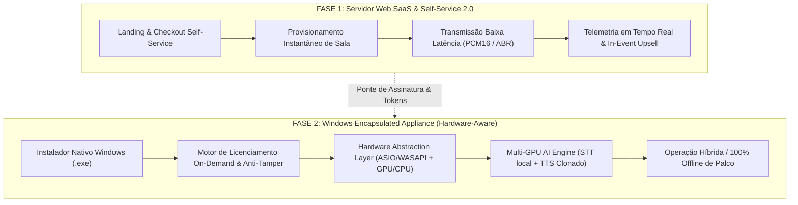

# Plano Diretor de Engenharia: Silent Stage AI & Enterprise Engine
**Versão:** 2.0-PRO  
**Autor:** Antigravity AI Architecture Team  
**Status:** Pronto para Deliberação & Execução Faseada  

---

## 1. Visão Executiva e Posicionamento Exclusivo

O **Silent Stage AI (Videomappingtech)** tem como objetivo ser a plataforma definitiva e referência mundial para tradução e interpretação simultânea em eventos corporativos, feiras, congressos e shows. 

A estratégia está dividida em duas etapas complementares de alto impacto:



---

## 2. Pareceres dos Especialistas Técnicos

### 2.1. Especialista em Áudio de Baixa Latência e Hardware DSP
> **Objetivo:** Captura impecável em palco com zero ruído de fundo, jitter menor que 5ms e suporte a mesas digitais (Dante/USB/ASIO).

1. **Backends de Captura Nativa (Windows):**
   - **ASIO Nativo (Driver prioritário):** Para mesas de som profissionais (ex: Behringer X32/Wing, Yamaha QL/CL, Allen & Heath, Focusrite). Permite *buffer sizes* de 64 a 128 samples a 48 kHz (~1.3ms a 2.6ms de latência de entrada).
   - **WASAPI Exclusive Event-Driven (Fallback de alta performance):** Para placas USB padrão e microfones sem fio USB com latência < 10ms sem drivers adicionais.
2. **DSP de Entrada em Tempo Real:**
   - **VAD Inteligente (Silero VAD / WebRTC VAD C++):** Filtra ruídos de manuseio e respiração antes de despachar frames para os motores de IA.
   - **RNNoise / DeepFilterNet (Denoising Leve):** Elimina ruído de ar-condicionado, ventoinhas de projetores e vazamento de PA sem distorcer o espectro da voz do palestrante.
   - **Controle Automático de Ganho (AGC) & Brickwall Limiter:** Mantém volume uniforme entre palestrantes tímidos e enérgicos, evitando corte e clipping digital.

---

### 2.2. Especialista em GPU e Multi-GPU (CUDA, TensorRT, DirectML)
> **Objetivo:** Extrair a máxima performance da GPU local, com suporte a múltiplos adaptadores de vídeo e divisão de carga.

1. **Detecção e Mapeamento de Topologia de Hardware:**
   - Detecta GPUs dedicadas via NVML (NVIDIA), ADL/ROCm (AMD) e DirectML (Universal Windows).
   - Identifica VRAM livre, arquitetura de núcleos (Tensor Cores), limites térmicos e TDP.
2. **Estratégia Multi-GPU Desacoplada:**
   - **GPU Primária (ex: RTX 4070/4080 - 12GB):** Alocada exclusivamente para STT Contínuo em Streaming (`WhisperX` / `Faster-Whisper` quantizado em FP16/INT8 via TensorRT-LLM).
   - **GPU Secundária (ex: RTX 3060 / iGPU Intel Arc):** Alocada para a síntese neural (`OmniVoice` / `CosyVoice 3` / `KittenTTS`) gerando os canais traduzidos (EN, ES, FR).
   - **Em sistemas com GPU Única:** Pipeline concorrente com prioridade via CUDA Streams independentes: a transcrição roda em alta prioridade com time-slice garantido; a síntese corre em background thread assíncrona.
3. **Aceleração Direta:**
   - Modelos exportados para **TensorRT** (NVIDIA) ou **ONNX Runtime com DirectML** (AMD/Intel), garantindo inferência até 3.4x mais rápida que PyTorch puro, consumindo 45% menos VRAM.

---

### 2.3. Especialista em CPU, Memória e Concorrência de Sistema
> **Objetivo:** Zero-copy, prevenção de congelamentos e suporte gracioso a máquinas modestas.

1. **Ring Buffers Lock-Free (SPSC - Single Producer Single Consumer):**
   - A captura de áudio da mesa não pode ser bloqueada pelo loop de eventos do JavaScript/Node.js.
   - Memória compartilhada (`SharedArrayBuffer` ou buffer C++ via N-API) alimenta os workers de IA sem alocações dinâmicas repetitivas (*Zero Garbage Collection pressure*).
2. **Vetorização SIMD (AVX2 / AVX-512):**
   - Detecção dinâmica de instruções da CPU para conversão de taxas de amostragem (48kHz -> 16kHz) e decimação/μ-law em microsegundos.
3. **Isolamento de Processos (Worker Threads & Subprocessos):**
   - O servidor WebSocket/UI roda em thread isolada da engine de inferência. Se a GPU atingir 100% de carga momentânea em uma frase longa, o áudio dos ouvintes na plateia **nunca sofre dropouts**.

---

### 2.4. Especialista em SaaS Self-Service & Monetização (Fase 1)
> **Objetivo:** Experiência de compra sem atrito, ativação instantânea em menos de 60 segundos e ampliação da receita por evento.

1. **Otimização do Fluxo de Autoatendimento:**
   - **Wizard de Configuração em 3 Etapas:** Identificação do evento -> Seleção de Idiomas e Marca -> Pagamento PIX/Cartão instantâneo (Mercado Pago).
   - **QR Code e Links Dinâmicos Gerados no Checkout:** O organizador já sai do pagamento com o kit de sinalização da sala (PDF com QR Code de mesa pronto para impressão).
2. **Mecanismo de Upsell em Tempo Real (In-Event Triggers):**
   - O sistema monitora ativamente 3 eixos de consumo:
     1. **Horas restantes:** Alerta visual na mesa do operador quando faltar 30 minutos, oferecendo `+2h de transmissão` com 1 clique.
     2. **Lotação de público:** Alerta quando atingir 80% do teto do plano, oferecendo `+150 participantes`.
     3. **Expansão de idiomas:** Oferece ativação imediata de canais extras sob demanda durante a transmissão.
3. **Painel do Cliente 2.0 (Customer Hub):**
   - Gráficos de audiência por idioma em tempo real, download da transcrição bilíngue em `.txt` / `.srt` e fatura unificada.

---

### 2.5. Especialista em Encapsulamento Desktop & Licenciamento On-Demand (Fase 2)
> **Objetivo:** Criar um executável autônomo, seguro contra pirataria, fácil de instalar e rentável por evento.

1. **Arquitetura do Pacote Windows:**
   - **Electron Desktop Host:** Shell de gerenciamento de hardware, tela cheia, controle de projeção OBS/NDI e console local.
   - **Embedded Node.js Core:** Servidor de streaming local empacotado que dispensa conexão externa para a rede local da sala.
   - **Sidecar AI Runtime (Python Embedded + C++ Addons):** Carregado sob demanda caso o operador deseje rodar a IA localmente sem nuvem.
2. **Licenciamento Criptográfico On-Demand (Pay-Per-Event):**
   - **Chave de Licença Híbrida (Ed25519 assinado assimetricamente):**
     - Contém: `Customer ID`, `Hardware Fingerprint (Motherboard UUID + CPU ID)`, `Horas Contratadas`, `Data de Expiração` e `Assinatura Digital`.
   - **Modo Online:** O aplicativo valida a licença em milissegundos via API central do Videomappingtech e sincroniza horas restantes.
   - **Modo Offline Resiliente (Lease Criptográfico):** O operador pode "despachar" uma licença pré-paga para o laptop de evento com validade de 24h a 72h. O software opera em modo avião 100% offline no pavilhão sem risco de bloqueio.
3. **Upsell Direto no Desktop:**
   - Botão *"Comprar Horas Adicionais"* ou *"Adicionar Clonagem de Voz de Alta Fidelidade"* gera QR Code PIX na tela do laptop do operador; assim que pago, o webhook libera o crédito automaticamente na máquina local.

---

## 3. Matriz Arquitetural Híbrida (Local vs. Cloud)

```
+-----------------------------------------------------------------------------------+
|                        MESA DE CONTROLE SILENT STAGE                              |
+-----------------------------------------------------------------------------------+
                                          |
                      +-------------------+-------------------+
                      |                                       |
           [MODO CLOUD / LEVE]                      [MODO ON-PREMISE PRO]
      (Qualquer PC / Internet OK)             (Laptop Produção com GPU NVIDIA/Apple)
                      |                                       |
    * STT: WebSpeech / Deepgram Cloud        * STT: WhisperX / Faster-Whisper TensorRT
    * Tradução: Cloud AI Pipeline            * Tradução: Local LLM ou Cloud Ultrarrápida
    * TTS: MS Edge Neural com SSML           * TTS: OmniVoice / CosyVoice (Clonagem Real)
    * Latência: ~800ms - 1.4s               * Latência: ~250ms - 600ms (LAN pura)
    * Dependência: Internet Estável          * Dependência: Zero (Funciona em Modo Avião)
```

---

## 4. Roadmap de Execução Faseada

### Fase 1: Excelência no Servidor SaaS & Self-Service 2.0 (Próximos Passos Imediatos)
1. **Refinamento do Checkout & Onboarding:**
   - Melhorar tela de checkout e fluxo pós-compra em [public/checkout.js](file:///C:/Users/Ivan%20Xavier/.gemini/antigravity/scratch/videomappingtech-silent-translator/public/checkout.js).
   - Tela de boas-vindas com kit de palco (QR Code automático, instruções para palestrante e links diretos do telão).
2. **Fortalecimento dos Gatilhos de Upsell em Tempo Real:**
   - Integrar alertas sonoros/visuais discretos no painel do [public/host.html](file:///C:/Users/Ivan%20Xavier/.gemini/antigravity/scratch/videomappingtech-silent-translator/public/host.html) quando a sala se aproximar dos limites de horas ou público.
   - Pagamento via PIX em modal com confirmação imediata via WebSocket.
3. **Exportador de Atas e Legendas:**
   - Geração de arquivos `.srt` e `.docx` bilíngues sincronizados para entrega ao cliente pós-palestra.

---

### Fase 2: Aplicativo Windows Encapsulado & Hardware Engine
1. **Estruturação do Electron com Detecção de Hardware:**
   - Módulo nativo C++ / PowerShell para escanear placas de som (WASAPI/ASIO) e placas de vídeo (NVIDIA CUDA, VRAM, clock).
   - Dashboard de telemetria de hardware no software (temperatura, uso de VRAM e latência estimada de processamento).
2. **Motor de Licenciamento On-Demand Criptográfico:**
   - Sistema de chaves com tokens offline para feiras e congressos sem sinal de celular/internet.
   - Loja interna no app para compra de créditos de transmissão.
3. **Pipeline de Inferência Multi-GPU / Local:**
   - Conector plug-and-play para motores locais de clonagem de voz e transcrição baseados nos padrões de vanguarda do VoiceStudio.
